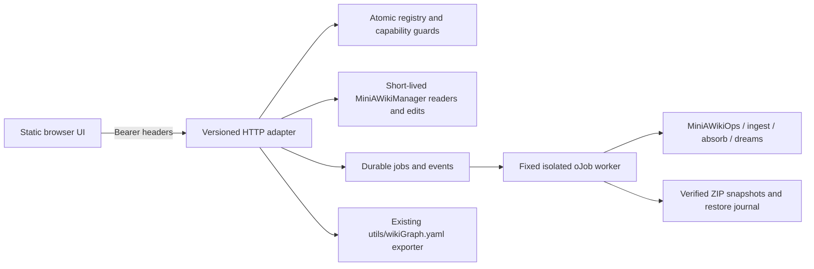
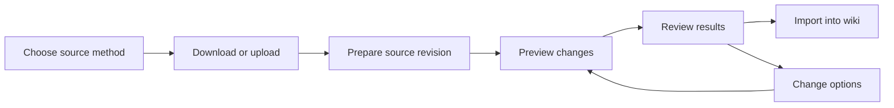

# Mini-A Wiki Studio

Wiki Studio is a separate, local, single-operator application. It does not change
the chat UI or the oPack's main command. Markdown and Mini-A's engine artifacts
remain authoritative; Studio keeps its registry, jobs and snapshots outside wikis.

This first implementation provides the local filesystem workflows below. It is
**not full acceptance of every feature in the original Studio specification**.
Unsupported adapters/backends are explicitly disabled, and verification limits are
listed at the end rather than represented as working integrations.

## Start without a model

Requirements: an OpenAF installation with oJob, the JVM `jdk.httpserver` module,
POSIX filesystem permissions/file locks, and a supported modern browser. Node is
used only by development tests. No model or Internet connection is needed to
start, register wikis, edit, search, export a graph or run maintenance plan.

Create a dedicated parent directory for allowed wiki roots, then run:

```sh
mkdir -p /private/tmp/studio-demo/wikis
ojob /path/to/mini-a/mini-a-wiki-studio.yaml \
  onport=8890 studiohome=/private/tmp/studio-demo/state \
  studioallowroots='["/private/tmp/studio-demo/wikis"]'
```

Use the absolute path to the installed oPack's job when launching outside its
directory. Libraries and assets are anchored to that job's bundle, even when a
different Mini-A version is installed. Updating the oPack requires restarting
Studio and reopening the browser; do not replace production files under workers.

Open `http://127.0.0.1:8890`. A fresh 256-bit bearer token is printed once at
startup and is valid for that process. For a stable token, configure the trusted
`STUDIO_TOKEN` environment variable with at least 32 high-entropy characters.
Do not put credentials in arguments, URLs or bookmarks. The browser retains the
token in memory only; reload requires signing in again. Tokens are not saved in
the registry/configuration. Securely manage any local terminal output yourself.

The listener binds an explicit `InetSocketAddress("127.0.0.1", port)` using the
JVM streaming HTTP server. OpenAF's own `httpd.start(port, host)` also supports an
explicit host; Studio uses the JVM interface to bound input while streaming.
Non-loopback binding is rejected. Host and Origin must match the local listener.
This release does **not** provide remote-origin/proxy trust configuration. Use a
local browser or a trusted local tunnel retaining the loopback origin; do not
expose it publicly or strip Origin checks to make a remote proxy work. A future
HTTPS proxy mode needs an explicit allowed public origin and proxy trust policy.

## Architecture and persistent state



The cohesive modules are `wiki-studio-{common,config,registry,api,pages,graph,
sources,jobs,operations,backups,ingestion,bootstrap}.js`. Both YAML entrypoints and
all production assets are included in `.package.yaml`. The canonical entrypoint
is the oJob; no `wikistudio=true` console-parser change is introduced.

State under `studiohome` includes `config.json`, `registry.json`,
`sources/records/<wikiId>/<sourceId>.json`, `sources/uploads/`,
`jobs/<UUID>/{job.json,events.ndjson,result.json,before.json,after.json,changes.json}`,
`graph-cache/`, `backups/<wikiId>/<backupId>/`, `locks/` and daily `audit/` files.
Directories are owner-only. JSON is written to a private temporary file, fsynced,
then atomically renamed. This covers process crashes; parent-directory fsync and
power-loss durability have not been established on all filesystems.

When upgrading from flat `sources/<wikiId>--<sourceId>.json` records, **stop
admitting requests, drain all old workers, then stop Studio before installing and
restarting this version**. Wiki locks now use `wiki-<wikiId>` names; mixed old/new
workers must never run concurrently because their locks do not coordinate.
Before starting its scheduler, Studio atomically copies legacy registrations using
their embedded wiki/source identifiers. Valid records already in the new layout
win, and an interrupted migration can restart. Legacy files and uploaded revisions
are retained. IDs, upload revisions and engine `ingestsourceid` provenance remain
unchanged. Review `sources/records/migration-report.json` and startup warnings:
registrations already overwritten by a legacy filename collision cannot be
reconstructed from that filename. Restore a verified record or register a fresh
upload; Studio reports missing registrations identified by upload seals without
guessing their contents.

## Wiki lifecycle and capabilities

Use **Add Wiki** to register an existing root or create a new directory. Roots must
be absolute, canonical, beneath an explicitly configured `studioallowroots`
directory, outside Studio state, and disjoint from registered roots. Registration
does not initialize existing content. Creation calls Mini-A's supported init.
Symlinks, hard-linked files, root identity changes and hidden page paths are
rejected. Use canonical paths on macOS (for example `/private/tmp`, not `/tmp`).

Settings supports display-name and ro/rw changes. Unregister removes only the
registry entry; it never deletes wiki data. Graph enabled/disabled is also
available through PATCH. Lexical configuration editing is not exposed yet.

| Backend | Browse/search | Edit | Graph HTML | Ingest/dream/absorb/restore |
| --- | --- | --- | --- | --- |
| Registered fs directory, rw | Yes | Yes | Yes | Yes, with operation gates |
| Registered fs directory, ro | Yes | No | Yes, cache outside wiki | No |
| Archive, HTTP, S3, ES, mounts | Disabled in Studio | No | No | No |

Mini-A's CLI/MCP readers still support their existing non-fs backends and mounts.
Studio does not accept connection credentials or promote mounts into rw roots.
`/session` and each wiki response expose the supported capabilities and reasons.
One v1 token maps to admin. Central guards already distinguish viewer, editor and
admin; per-wiki ro overrides mutation privileges. Separate role tokens are not
configured in this release.

## Pages and graph

Pages offers a bounded collapsible folder tree, paginated path list, search, raw editor, safe preview, frontmatter,
outgoing links and backlinks. The textarea is deliberately dependency-free; this
release does not bundle CodeMirror. HTML is rendered as text, images/media are
not embedded, and only HTTP(S) links or resolved local page buttons are active.
The small renderer supports headings, code blocks and wiki/Markdown links; it is
not a full CommonMark renderer. Mount links show an unavailable message.

GET page returns **complete** UTF-8 content, SHA-256 of raw bytes and metadata,
or a size error; it never disguises a bounded agentic read as a complete page.
Saves require the expected revision and return 409 on mismatch. Local edits are
retained for comparison/merge. Typing can continue during a save; repeated keyboard
saves join that request. A successful response advances the server revision while
keeping newer text dirty and editable. Save again to publish those newer edits. Frontmatter comments and newline style survive
Studio writes through the manager's opt-in `preserveRaw` option. Other manager
callers retain existing serialization behavior. Invalid frontmatter blocks save.
Move/delete use manager semantics and create a full snapshot first. Moves preserve
existing link/index handling. Source-managed metadata is displayed where present;
future ingestion may conflict with manual edits and must not silently overwrite
them. Search preserves the engine's partial-coverage warnings: no result does not
establish absence. All-wiki search coordinates up to 20 registered wikis and reports per-wiki coverage, namespaced results and omitted wikis. Page history is not provided.

Graph uses `utils/wikiGraph.yaml`, not a second graph engine. Generated HTML is
cached outside the wiki under a content-and-graph fingerprint, with at most three
cached HTML exports per wiki. External changes invalidate the cache on export.
Persisted snapshots are labelled knowledge graph; without one the exporter scans
Markdown links. Snapshot presence alone does not establish freshness or semantic
extraction. Graph rebuild defaults to `semantic=false`.

HTML is fetched with an auth header, converted to a Blob and displayed in an
`allow-scripts allow-downloads` sandbox with no same-origin permission. Its CSP
denies network connections. Fixed renderer script/style nonces satisfy the parent
CSP inherited by Blob documents. Node events carry a versioned schema; the parent
checks source window, opaque origin, document ID and safe Markdown path before
opening the page. Concept nodes do not navigate. The standalone exporter remains
offline-compatible. **Download offline HTML** and the Pages list are alternatives
when a browser blocks sandboxed Blob frames. The in-app browser used during this
implementation did not render the Blob iframe; no visual graph success there is
claimed. Exporter and simulated DOM node-navigation tests pass.

## Sources, uploads and incremental hydration

Select the destination wiki first. Sources supports browser directory selection
and ZIP upload, staged file inventory, stable source IDs, immutable upload
revisions and bounded lineage. Reuse the source ID for a later uploaded revision.
Registrations are scoped to the selected wiki and verify their embedded ownership
on reads. Publication and run-status updates share a source lock; an older job
cannot replace the status or revision of a newer registration. Upload quota checks
traverse file metadata without re-reading previous uploads. Sealing and ingestion
still hash all source bytes.

The destination section defaults to the stable source ID, rather than the internal
upload directory name. Change **Advanced options → Destination section** to override
it; an empty field uses the source ID. Source layout preserves uploaded folder paths
beneath that section. Existing pages are not moved automatically; to keep updating
an older import under `files` (or `expanded` for ZIPs), explicitly use that section.

Stage first, then choose Preview or Apply; filenames never select a destination.
Preview is the ingestion engine's dry run, not a guaranteed model-generated diff.
Auto/normalize/raw/distill, source/flat layout, section, include/exclude, prune and
explicit semantic settings map to the existing bounded engine. `maxfilesize` is
translated to HEAD's `ingestmaxfilekb`; selected file-count limits are checked by
Studio before dispatch. Raw mode is useful for the model-free walkthrough.

Uploads stream one file per request to disk. Limits: 8 MiB per Markdown/text/PDF,
20 MiB per ZIP, 2,000 entries, 64 MiB expanded batch, depth 16, expansion ratio 100.
ZIP preflight rejects encrypted/special/symlink entries, traversal, duplicate
case-folded paths, unsupported members, ZIP64 and multipart archives. Extraction
checks actual byte counts and CRC. Imported scripts are never executed. PDF
ingestion depends on the converters available to the existing engine; staging
acceptance does not promise successful conversion. ZIPs containing other file
types must be filtered before upload. Upload resume/TTL cleanup is not implemented.

For operator-allowlisted local folders or existing Git checkouts, add:

```text
studiosourcedirs='[{"id":"docs","path":"/data/source-checkout"}]'
```

Sources then offers that named directory. The browser supplies only its ID, never
an arbitrary source path. Intake snapshots visible `.md`, `.txt` and `.pdf` files;
hidden state/instructions and other formats are skipped. It does not execute Git
hooks, update the checkout or infer a remote commit. Refresh the checkout outside
Studio, then create a new source revision with the same source ID.

**Webpage and YouTube-caption adapters** fetch from the Studio server using
`js/studio/wiki-studio-outbound.js`, a bounded transport: only `http`/`https` on ports 80/443,
no URL credentials, the host is resolved once and every answer must be a public
address (loopback, link-local/metadata, private, CGNAT, multicast, documentation and
mapped ranges are refused), the socket connects to that resolved IP (no second DNS
lookup, so rebinding cannot swap it) while TLS still verifies the original host name,
redirects are followed manually (max 5) and re-validated per hop, responses are
capped at 5 MiB, and the whole request has a 30 s deadline. Any public host is
allowed; there is no operator host allowlist. Pages are converted with the installed
`mdconvert` oPack (HTML only; text/Markdown pass through) into one Markdown file with
`Source:` and `Retrieved:` lines. YouTube retrieves existing captions only (manual
preferred, then automatic; no speech-to-text) from fixed YouTube hosts, mirroring
the `ytTranscript.yaml` recipe. Both are staged as a normal source revision
(`type: web|youtube`, with `origin`), and ingested only after Preview/Apply.
API: `POST /sources {id,name,type:"web",url}` or `{type:"youtube",video,lang}`.
**Remote Git clones remain disabled**: a `git` subprocess cannot use the pinned
transport. Upload a reviewed checkout or ZIP, or use `studiosourcedirs`.

Apply snapshots the destination first and uses a stable namespaced
`ingestsourceid`. The engine retains conflicts, receipts, journals and incremental
ownership. A partially blocked import is reported partial. Prune is always opt-in;
empty-source destructive authorization is not exposed. No force-overwrite option
is exposed. Ingestion recovery list/resume/discard is available through the
ingestions endpoint with `action` and optional `recoveryId`; discard is not rollback.

## Absorption

Absorb selects other registered fs wikis and optional paths/tags/topic/exclusions.
Studio constructs the source roots; clients cannot send absorbspec roots. Plan,
show, status, apply, resume, delete and cancel use the existing saved-plan engine.
Inspect the plan/job result before apply. Applying/resuming requires explicit
confirmation, a Studio-generated completed plan and a verified destination
snapshot. Source identities are rechecked and source Studio locks held. The
engine enforces stale-plan checks, skill preservation and journal recovery.
Deleting/cancelling a saved plan never undoes pages already written. Plan may
need a configured model; apply reuses the saved plan rather than regenerating it.
Real-model synthesis was not tested by this implementation.

## Dreams, backups and recovery

| Mode | Meaning | Studio safeguards |
| --- | --- | --- |
| plan | Model-free maintenance diagnostics | Read-only manager; full file-manifest equality checked; semantic rejected |
| auto | Existing diagnose/repair engine | Preview default; snapshot before mutating run |
| apply | Repair/navigation/index/graph maintenance | Snapshot; semantic off by default |
| repair | Existing lint repair | Snapshot |
| indexes | Regenerate directory index.md pages | Snapshot even though the utility default does not cover this mode |
| reindex | Rebuild search artifacts | Exclusive Studio lock |
| graph | Structural graph, optional semantics | Semantic off by default |
| reorg | Live LLM structural changes | Admin confirmation; verified snapshot; all existing reorg gates |

Reorg is not an immutable plan/apply contract. Maintenance plan must never be
described as its exact preview. Configure trusted `OAF_MODEL` in the server
environment only for model-dependent work; credentials are inherited by workers,
not persisted in jobs. Per-operation model presets/cost estimates are not offered;
the supported explicit model step budget is 1–100. No cost is invented.

Mutating batch dreams/imports/absorption/restore cannot start without a verified
backup. Mini-A's ZIP helper includes the full wiki, including hidden engine state;
Studio adopts the archive into its protected backup inventory only after
archive/member SHA-256 verification and unchanged-root checks. It does not produce
another automatic utility backup. The archive is a snapshot, never an editable
reorg plan. Before/after manifests report created/deleted/modified paths, hashes,
bounded unified replacement hunks and equal-hash move **candidates**. Large-file
diffs are explicitly truncated. Failed pre-finalization work may have no finalized
comparison; inspect the snapshot and engine journal locally.

Restore requires the selected wiki's backup ID, current full-tree fingerprint and
explicit offline confirmation. It creates a pre-restore snapshot, verifies and
extracts into a sibling directory, checks the extracted manifest, then renames
the live root aside and activates the validated tree. The former live tree remains
as `.studio-replaced-<jobId>` for local recovery; it is never silently deleted.
The registry inode is updated only after activation. Check search/graph health and
reopen all readers afterwards. File modes are not fully preserved; private
directories protect restored content. Snapshots cannot roll back external models,
services or remote data.

A process crash between the two renames can leave a restore journal requiring
manual recovery. Stop Studio and all external processes. Inspect
`jobs/<jobId>/restore.json` and the tracked pre-restore backup. If the original
root is absent and `replaced` exists, rename `replaced` back to the registered
root. If both exist before registry finalization, preserve the activated root at
another unused sibling path and put `replaced` back. This restores the original
root identity. Never overwrite/delete either tree to make the error disappear.
Validate the recovered content before restarting. Automated crash-interrupted
restore recovery is not implemented; successful restore and failed preflight are
tested, but crash-injection across every rename boundary is not.

## Jobs, locks, health and limits

Jobs are acknowledged only after persistent state/events. Two isolated workers
can progress across distinct wikis; each wiki has one exclusive Studio OS lock.
Short readers close their managers. Queued/running maintenance blocks Studio page
reads/edits; offline compaction/restore holds the lock for the whole operation.
Absorption also locks its sources. These locks do not stop arbitrary external
CLI processes. **Stop external readers/writers before compaction, restore and
structural operations.** Pending known ingest/absorb journals block manual saves.

State progresses through queued, acquiring-lock, preflight, backup, running,
refreshing and terminal completed/partial/failed/recovery-required. Server restart
marks nonterminal jobs interrupted; it never automatically replays them. An old
worker may still finish while holding its OS lock. Inspect engine recovery before
explicitly submitting a new job. Cancellation immediately cancels a queued job;
active engines lack safe abort checkpoints, so only a cancellation request is
recorded and they may complete with writes. There is no force-stop UI or claim of
undo. Child process stdout/stderr is discarded; structured engine callback logs
are retained/redacted. This is not a promise to capture every library print.

The processing banner offers **Cancel requests**, including while request details
are collapsed. Expand the details to cancel an individual request. Queued requests
are removed before sending; active requests and uploads stop waiting in the browser.
Server work already started may continue, and cancellation does not undo writes.
Check Activity before retrying a change whose response was cancelled. Background
jobs have a **Request cancellation** button beside **View activity** and in their
details; this uses the job cancellation behavior described above.

Events use authenticated finite SSE replay responses with cursor/Last-Event-ID
and a heartbeat comment; the UI fetches/reconnects and deduplicates sequences.
There is no EventSource URL token. Each event log is capped at 1 MiB, result at
approximately 1 MiB, browser event display at 100,000 characters. Terminal status
is calculated from the complete engine result before retention truncation; stored
summaries keep outcome fields, so partial and cancelled runs remain distinct and
recovery-dependent history remains protected. Job inventory
stops at 1,000 records. Wiki scans stop at 20,000 files/512 MiB/16 MiB per file;
editor pages at 1 MiB; embedded graphs at 5,000 nodes/30,000 edges/8 MiB output.
These are fixed v1 bounds, not a configurable quota/retention UI.

Overview/Health shows actual engine context/lint, published-index presence,
graph statistics/source, full revision fingerprint and known pending journals.
Missing freshness/semantic/model metrics remain unknown. Dreams provides manual
reindex, graph, directory-index regeneration and explicitly offline compaction.
Jobs/Sources/Backups show persistent history. No automatic health repair runs.

Audit covers authenticated mutation attempts without bodies/query secrets. Daily
audit files stop at 8 MiB. Graph cache evicts old exports; other jobs, backups and
staging are deliberately not automatically deleted, so recovery references cannot
expire silently. Stop workers and archive terminal job/staging/audit directories
locally after checking backup/journal references. Configurable retention, global
disk quotas, abandoned-upload cleanup and a reviewed cleanup UI remain follow-up
work. Secure state and backup locations like the wikis themselves.

## HTTP API examples

All data endpoints require `Authorization: Bearer <STUDIO_TOKEN>` and return JSON
UTF-8 or the documented HTML/SSE type. Errors use
`{error:{code,message,details?},requestId}` with status codes. Lists use bounded
offset/limit, normally at most 200. There is no shell or generic oJob endpoint.
Job creation requires an `Idempotency-Key`; same key/wiki/operation/payload returns
the original job, while a different payload conflicts. Registration/page creation
uses ID/path conflicts rather than persistent idempotency replay.

```sh
curl -H 'Authorization: Bearer <STUDIO_TOKEN>' http://127.0.0.1:8890/api/v1/wikis
curl -H 'Authorization: Bearer <STUDIO_TOKEN>' \
  'http://127.0.0.1:8890/api/v1/wikis/example/page?path=index.md'
curl -X POST -H 'Authorization: Bearer <STUDIO_TOKEN>' \
  -H 'Content-Type: application/json' -H 'Idempotency-Key: example-plan-001' \
  -d '{"mode":"plan","options":{"semantic":false}}' \
  http://127.0.0.1:8890/api/v1/wikis/example/dreams
```

Routes: `/health`, `/session`, `/wikis` (GET/POST), `/wikis/:id`
(GET/PATCH/DELETE unregister); under a wiki: `/overview`, `/tree`, `/pages`,
`/page`, `/pages/move`, `/search`, `/backlinks`, `/lint`, `/graph/stats`,
`/graph/related`, `/graph/html`, `/graph/rebuild`, `/sources`, `/ingestions`,
`/absorptions`, `/dreams`, `/maintenance`, `/backups`, `/backups/:id/restore`,
`/changes?jobId=...`; globally `/uploads`, `/jobs`, `/jobs/:id`,
`/jobs/:id/events`, `/jobs/:id/cancel`, `/audit`. Methods match their read/write
purpose. Upload uses raw file bytes with `X-Upload-ID: <UUID>` and percent-encoded
relative `X-Upload-Path`, then a source registration seals the batch. This is a
streamed-file protocol, not multipart or resumable upload.

## Walkthrough and validation

Follow [the two-wiki walkthrough](../examples/wiki-studio/README.md). The default
walkthrough makes no model calls. Optional reorg requires your configured model,
explicit confirmation, stopped external processes and verified backup. Inspect
actual changes and exercise a restore on disposable data first.

Tests: `ojob tests/wikiStudio.yaml`, `python3 tests/wikiStudioHttp.py`,
`python3 tests/wikiStudioPackage.py`, `python3 tests/wikiGraph.py`, and existing wiki/ingest/absorb/dream/graph/utility
suites. The HTTP test creates disposable directories, clears model variables and
launches real child workers from an unrelated working directory. It accepts
`--base /path/to/extracted-opack` for package smoke testing. Unit tests include an
injected deterministic restructuring engine, not live-provider quality evidence.

Implemented milestones: M0 baseline; M1 authenticated server/registry; M2 pages;
M3 exporter bridge/cache; M4 jobs/staging; M5 local hydration/absorption adapters;
M6 verified snapshots/dream safeguards/restore; M7 local UI/docs/package tests.
Remaining original acceptance items include remote adapters, connected non-fs
readers, configurable model references and
budgets, richer freshness dashboards, automatic retention, seamless interrupted
restore recovery and full browser/provider absorption/reorg coverage. The in-app
browser Blob-frame limitation is reported above. CRDT, scheduling, a new database
and an exact LLM reorg pre-approval plan are intentional non-goals.

### Test a wiki in Mini-A Web

When Studio inherits a non-empty `OAF_MODEL`, the wiki Overview offers **Open wiki test in new tab**. **Enable Advanced view** is an explicit, unchecked opt-in for trusted console controls. The child server inherits model configuration and opens the selected wiki with `wikiaccess=ro`, retrieval v2 enabled, and `useshell=false`. Each wiki/view-mode pair reuses its running test server; child servers stop when the Studio process exits normally. Allow browser pop-ups for Studio. Startup reports an error if the server does not listen within 30 seconds.

**Build web command**, available on the wiki dashboard and Overview, opens a command-preview wizard even without a configured model. Select one or more registered wikis, choose a port and mode (`webini` by default), and optionally enable Advanced view. A single wiki uses `wikiroot`; multiple wikis use named read-only `wikimounts`. The copyable `ojob` command uses this installation's `mini-a-web.yaml` and quotes arguments for macOS/Linux shells. Run it in a terminal with `OAF_MODEL` configured. Generating or copying the command does not execute it.


## Task-oriented workspace

Opening a wiki starts in **Pages**. Expand folders in the Explorer-style sidebar,
select a file to read it, and choose **Edit** to change Markdown. Arrow keys,
Home/End, Enter and type-ahead navigate the tree. Folder contents load in pages of
100, including empty folders. Search results retain the tree and offer **Reveal
in tree**. The Graph viewer is available from the Pages toolbar.

The main navigation groups existing capabilities into Overview, Pages, Import,
Maintenance, Activity and Settings. Overview shows counts and current activity;
Maintenance separates health findings, engine tasks, backups and recovery.
Technical records remain available in expandable details. Local Chart.js renders
category comparisons with equivalent data tables when charts are unavailable.

### Import workflow



Webpage and YouTube inputs each have their own adjacent download action. Source
name/ID are part of the selected method. Choose **Update source** in the library
to create another revision of an existing source. Preview estimates engine
changes; it is not a guarantee of identical future model output. Changing
options invalidates the preview. Application checks that the source revision is
still current. Advanced options retain modes, layout, filters, pruning and
semantic extraction. Import from another wiki retains saved Absorb plans and
all their lifecycle controls.

Submissions show background progress without replacing the current form. Open
activity details to inspect results, changed pages and processing logs. Import
forms remain in memory when moving between sections; credentials and form drafts
are not persisted to browser storage.

### History and snapshot cleanup

Activity supports individual, selected and all-eligible history deletion within
the current wiki. Confirmation lists the eligible count and protected exclusions.
Deleting history removes logs/results and frees the 1,000-job inventory limit;
it leaves wiki files, source revisions, saved plans, snapshots and audit logs.
Small receipts outside the live job inventory prevent an old request from
executing again and retain the authorization required to apply a saved Absorb
plan. A replay of a deleted request returns `410 job_history_deleted`.

Active jobs and unresolved recovery are protected. Resolve engine journals or
restore a snapshot, inspect the result, then **Mark recovery reviewed** in the job
details. This acknowledgment does not repair the wiki or delete engine journals;
the server refuses it while work or pending journals remain.

Backups lists manual/automatic origin separately from automatic verification at
creation. Both kinds can be deleted, except while active work or unresolved
recovery depends on them. Deleting the last verified backup requires an explicit
acknowledgment. Restore continues to verify the archive and create a pre-restore
backup. No automatic retention policy is enabled.

Additional HTTP interfaces (same authentication and path protections):

- `GET /api/v1/wikis/:id/children?path=&limit=100&offset=0`: immediate folder/file entries, folders first.
- `DELETE /api/v1/jobs/:id`: `{wikiId, confirmation:"delete-history"}`.
- `DELETE /api/v1/jobs`: `{wikiId, ids:[...], confirmation:"delete-history"}`; exact IDs are confirmed, with eligibility rechecked under locks.
- `POST /api/v1/jobs/:id/review-recovery`: `{confirmation:"<job-id>"}`.
- `DELETE /api/v1/wikis/:id/backups/:backupId`: `{confirmation:"<backup-id>", acknowledgeLast:false}`; use `true` only after confirming last-backup deletion.

Job and snapshot listings include `deletion: {allowed, reason}`. Cleanup requires
an administrator. Snapshot deletion also requires an editable wiki. Existing
state needs no migration; receipts and origin metadata are written when history
is removed. A process interruption during deletion may leave disposable files
under `studiohome/deleted-history`, outside the scheduler inventory.

### Redesign verification

Run `node tests/wikiStudioUI.cjs` for tree keyboard/read/edit behavior, import
control grouping, draft retention, preview invalidation and chart fallback.
`ojob tests/wikiStudio.yaml` additionally covers cleanup permissions, recovery
protection, request replay, last-backup acknowledgment, folder pagination and
saved-plan application after deleting history. `python3 tests/wikiStudioHttp.py`
and `python3 tests/wikiStudioPackage.py` exercise real HTTP workers and packaged
assets. Browser acceptance should include dark/light themes, narrow layouts,
200% zoom, keyboard focus and external edit conflicts. Real model-driven
reorganization and live remote downloads require separate configured checks.

### Graph build controls

Graph exposes structural/semantic extraction, off/automatic model assistance, incremental/full/resume strategy, force, presets, custom budgets, and shared saved defaults. See [Graph builds](GRAPH-BUILDS.md). Semantic extraction works without models. `GET /graph/settings` displays effective defaults; `PUT /graph/settings` saves them for a writable wiki. `POST /graph/rebuild` accepts the shared build options. Graph cancellation checkpoints completed work and stops scheduling calls; an in-flight request uses its configured timeout.

## Recursive folder operations

Select a folder in **Pages** to use **Move/rename folder** or **Delete folder**.
These administrator actions support registered local writable filesystem wikis.
The preview lists the source, destination, page/file/folder counts and surviving
pages with incoming links. Every nested file, attachment and empty directory is
included. Review the preview, and type the exact source path for deletion.

A move requires an existing destination parent and an unused destination name;
folders are never merged or overwritten, and no redirect pages are created.
Moves rewrite internal links, incoming links, relative attachment references and
ingestion ownership. Deletion preserves links in surviving Markdown so **Lint**
can report them. Root paths, protected engine state, symlinks, mounts and
read-only or unsupported backends cannot be changed.

Studio queues one durable, deduplicated background job for each operation.
The worker rechecks the preview revision under the shared wiki writer lock,
creates verified recovery snapshots, changes the subtree and publishes the final
navigation/search/graph indexes. If another edit makes the preview stale, the job
fails without changing content; preview again. On success Explorer opens the
moved folder or selects the deleted folder's parent.

Use **Activity** for progress, errors, changes and the associated snapshot.
An interrupted write or failed index/graph publication requires recovery and
blocks new maintenance. Stop other readers and writers before restoring the
verified Studio snapshot. Snapshot restoration restores the entire wiki, not
just the selected folder. The engine also retains a verified directory snapshot
beside the wiki and a pending journal inside `.mini-a-wiki-folders`; Wiki Manager's
**Restore pending folder snapshot** can roll it back using the exact recovery ID.
Reopen readers after restoration. Do not delete pending recovery files; successful
engine directory snapshots are retained until an operator removes them.
