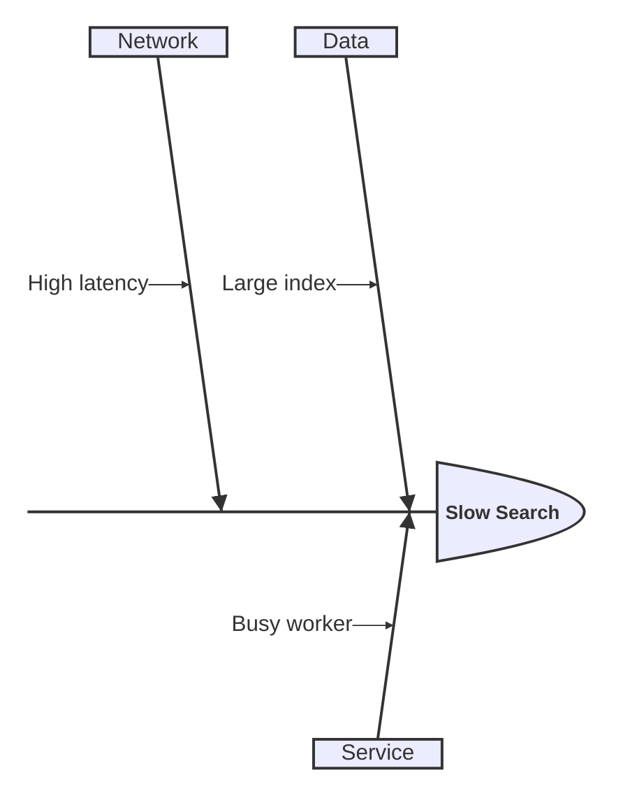
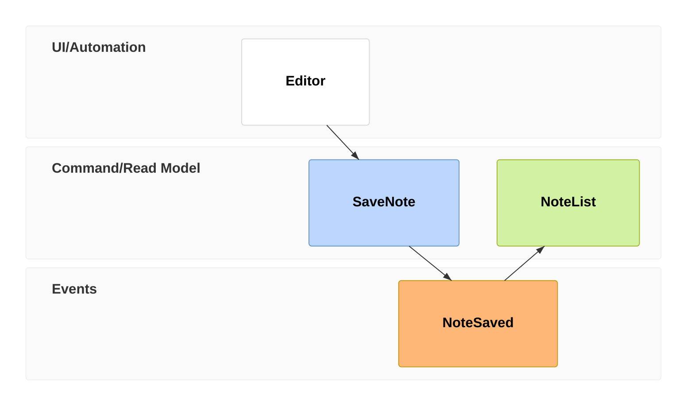
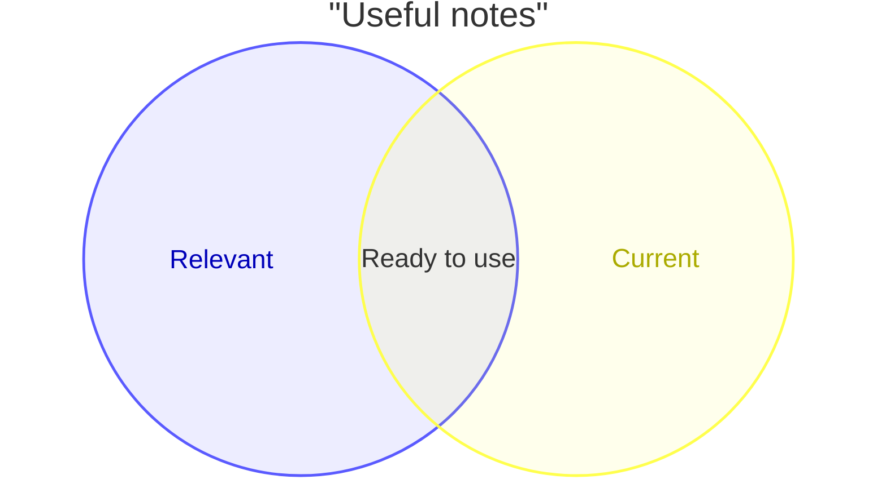

# Mermaid 12.0.0: analysis and trees

Examples are illustrative. Verify these experimental families against the deployed renderer, especially when the installed oPack differs from the baseline. Keep strict mode.

## Ishikawa

The first indented line is the effect; subsequent indented branches are cause categories and nested causes.



## Event modeling

Ordered `tf` entries model UI, commands, events and read models. `->>` references the source entry id; ids must be distinct.



## Venn

Declare sets before intersections (`union`). Optional sizes/styles must use Venn syntax; do not assume areas are proportional without supplied sizes.



## TreeView

Indent directories/files consistently; trailing slash marks a directory. Quote names with spaces. Unicode icons can be self-contained; custom icon maps need supported configuration.


## Wardley

Coordinates are [visibility, evolution], both normalized. Declare anchors/components before dependencies; `evolve` marks a future evolution position.

```mermaid
wardley-beta
  title Notes service
  anchor Reader [0.95, 0.8]
  component Search [0.7, 0.5]
  component Index [0.4, 0.7]
  Reader -> Search
  Search -> Index
  evolve Index 0.9
```

## Cynefin

Use clear, complicated, complex, chaotic and confusion domains. Indent items under domains; labelled arrows may connect domains.

```mermaid
cynefin-beta
  title Search incident
  clear
    "Apply known fix"
  complicated
    "Inspect query plan"
  complex
    "Try a small experiment"
  chaotic
    "Restore service"
  confusion
    "Collect evidence"
  complex --> complicated : "Pattern found"
```
