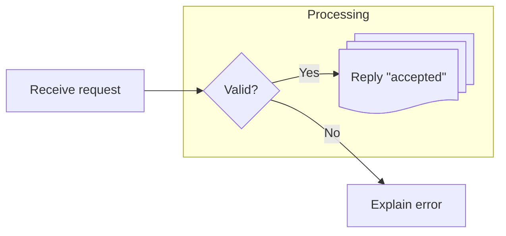
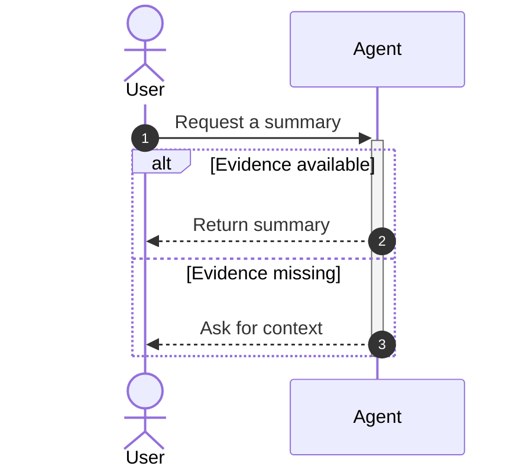
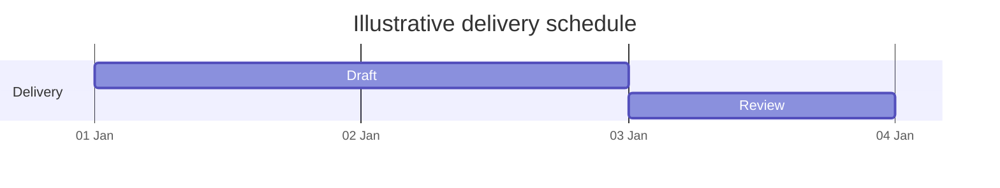

# Mermaid 12.0.0: flow, interactions and schedules

Read this file only for these families. Examples are illustrative; use supplied facts and dates for real work. Use `mermaid` fences and preserve strict mode.

## Flowchart

Use stable identifiers and double-quoted labels. Inner quotes use `#quot;`; traditional labels use ` ` for line breaks. `@{ shape: ..., label: ... }` selects expanded shapes. Group related steps with subgraphs; use LR/RL/TB/BT for direction. Avoid unquoted lowercase `end` as a node label.

## Sequence

Declare participants or actors. Use `alt/else/end`, `opt`, `loop`, `par/and/end`, notes and activation for interactions. Flowchart quoting rules do not apply to participant aliases or messages.

## Gantt

Set `dateFormat`; give tasks identifiers and use `after <id>` for dependencies. `section`, `milestone`, `crit`, `active`, `done` and `excludes` describe schedules. Use actual dates/durations for real plans.

