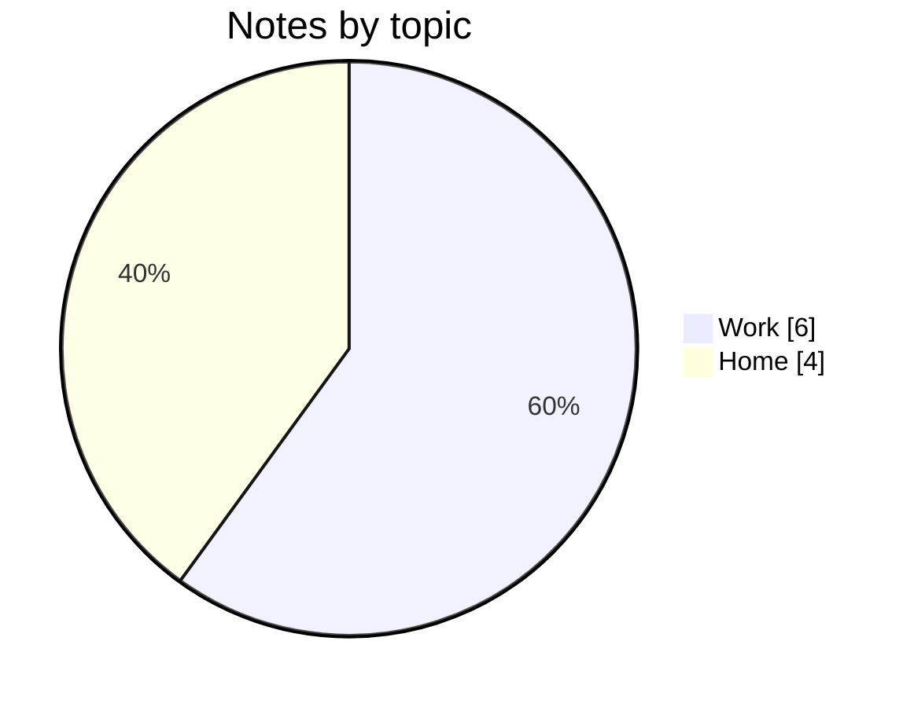
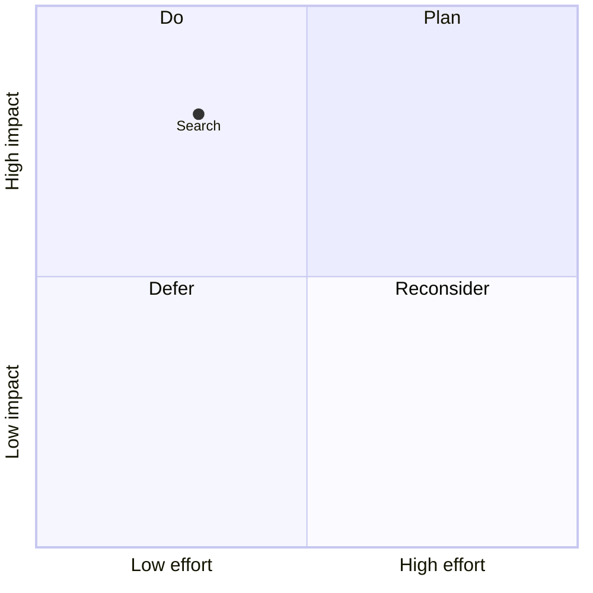
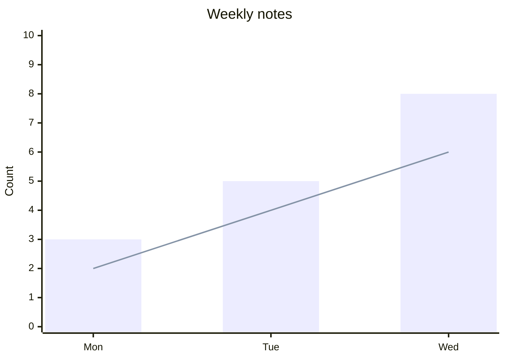
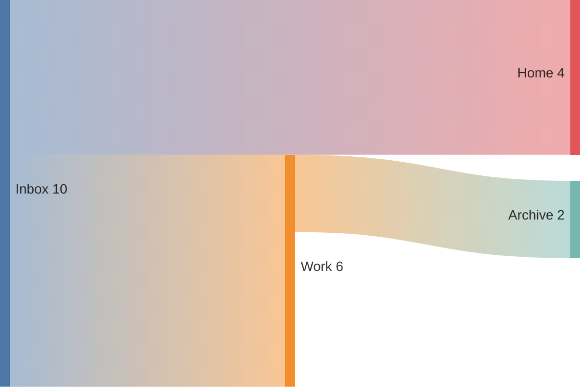
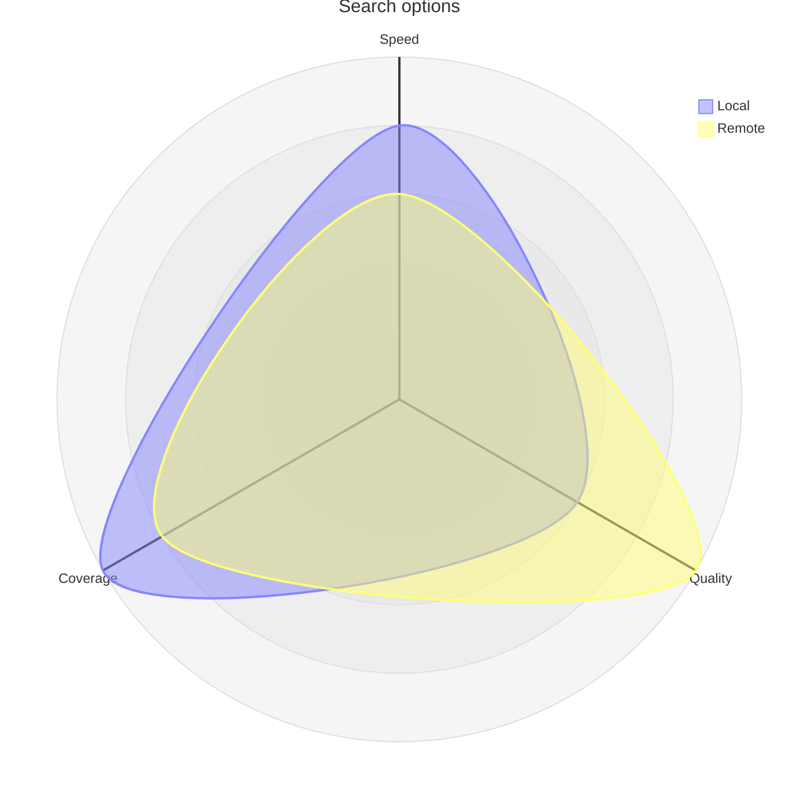
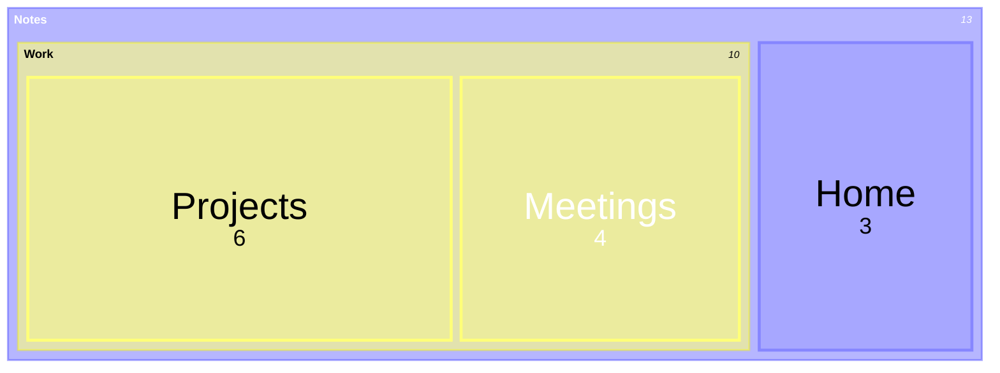
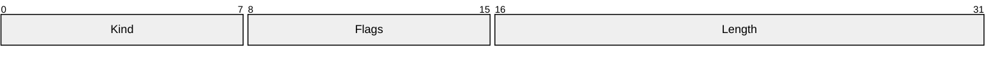
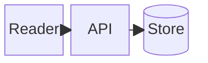

# Mermaid 12.0.0: quantities and layout

Examples use illustrative values. Match labels to values; do not invent real measurements. Preserve strict mode and theme defaults.

## Pie

Quoted labels map to nonnegative values; `showData` displays values.

## Quadrant

Points use normalized coordinates in [0,1]. Set axis ends and quadrant labels; optional point styling uses this family's grammar.

## XY

Use aligned category/value arrays; `bar` and `line` can share axes. Use Chart.js for scatter/bubble plots when enabled.

## Sankey

Rows are CSV source,target,value without a header. Use positive weights; quote names containing commas.

## Radar

Each curve has one value per axis, in axis order. Set min/max and optionally `graticule polygon`.

## Treemap

Indent quoted groups and leaves; only leaves receive numeric values. The keyword is `treemap-beta`.

## Packet

Inclusive bit ranges label fields. Use explicit offsets or the renderer's relative-width syntax; these are bit lengths, not byte counts.

## Block

Set column count, node spans (`:N`) and `space` explicitly. Nested blocks group layouts; arrows connect declared block ids.

