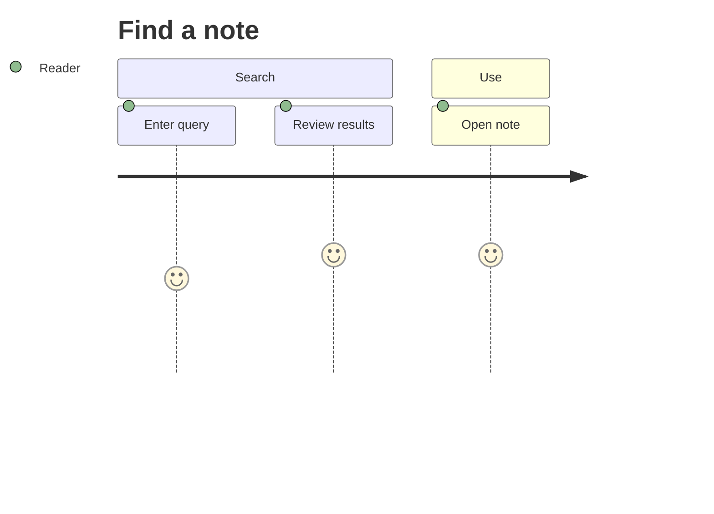
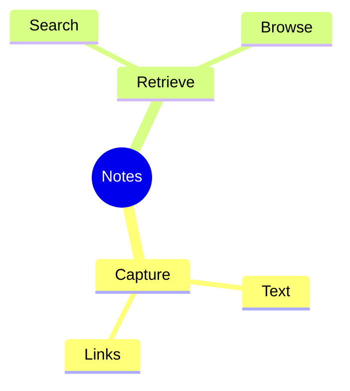
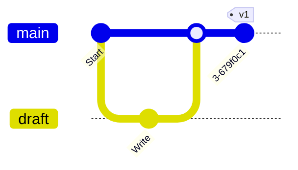
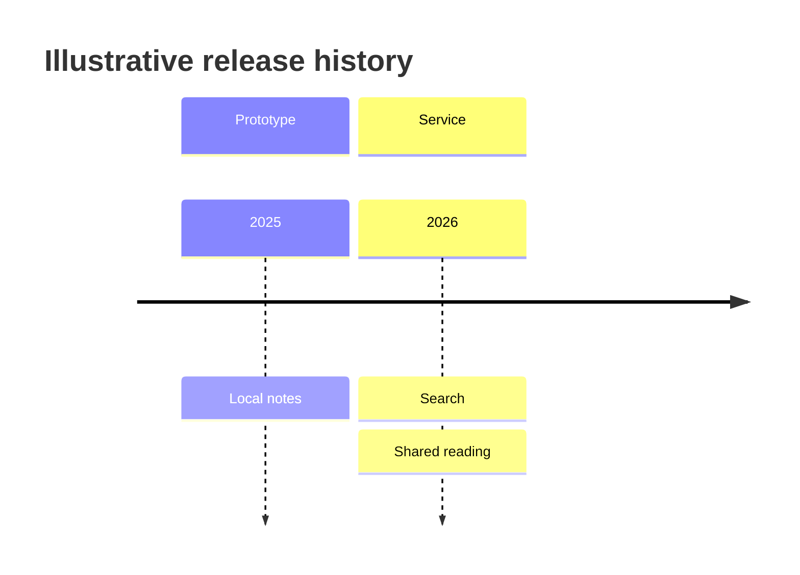
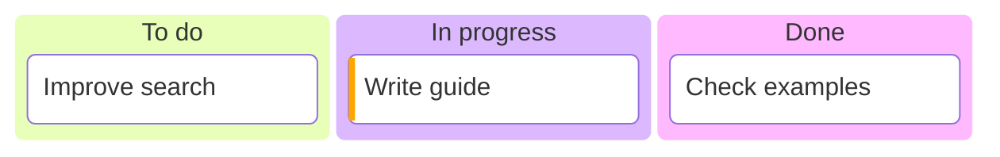

# Mermaid 12.0.0: work and history

Examples are illustrative. Load only when these families fit the request; preserve supplied facts and strict mode.

## User journey

Tasks have `label: score: actors`; sections group stages. Scores describe experience, not durations.

## Mindmap

Indentation defines hierarchy. Shapes are optional; avoid icon classes that depend on unloaded fonts.

## Git graph

Use commit, branch, checkout and merge in executable order. Optional commit `id`, `tag` and `type` annotate history; do not merge a branch into itself.

## Timeline

Use `period : event` and sections for phases. Additional colon-prefixed events share the preceding period.

## Kanban

Indent cards under columns. Stable identifiers and quoted labels are useful; optional `@{ assigned: ..., priority: ..., ticket: ... }` metadata annotates cards. External ticket links depend on host settings.

