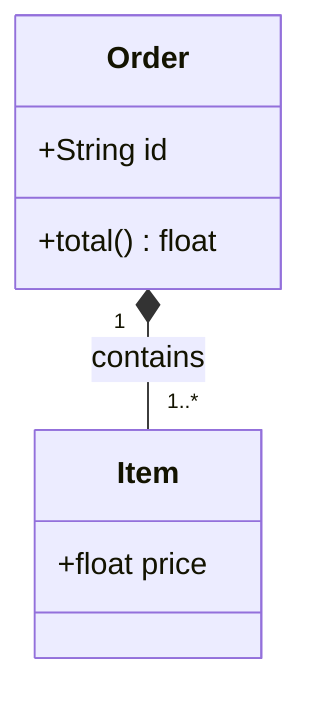
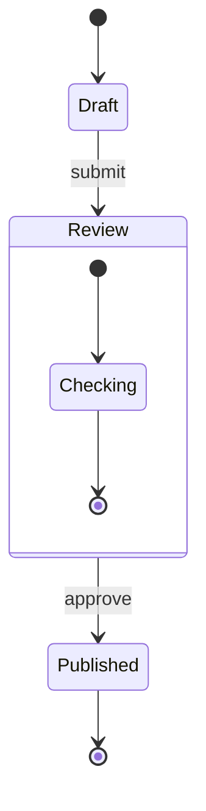
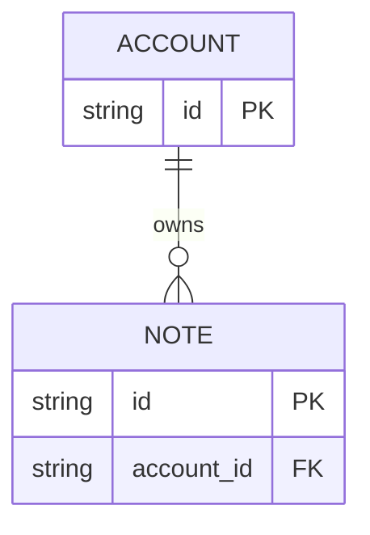
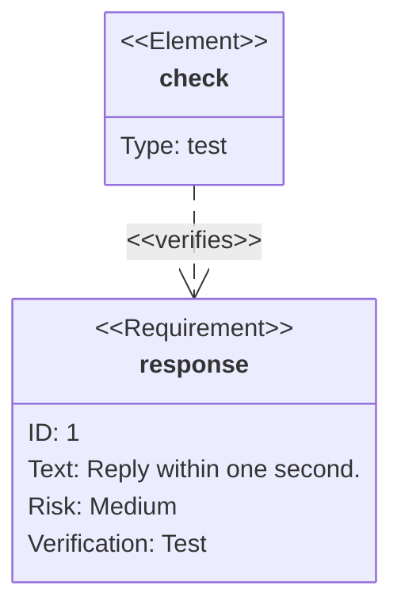
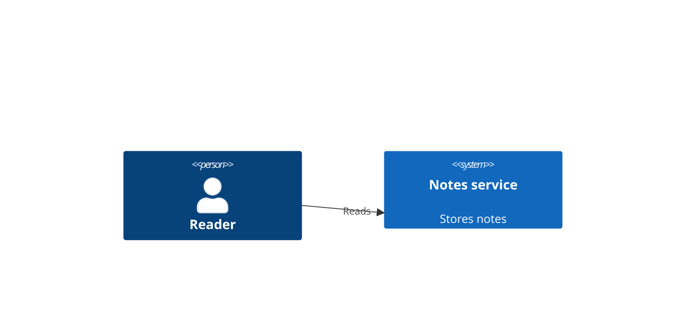
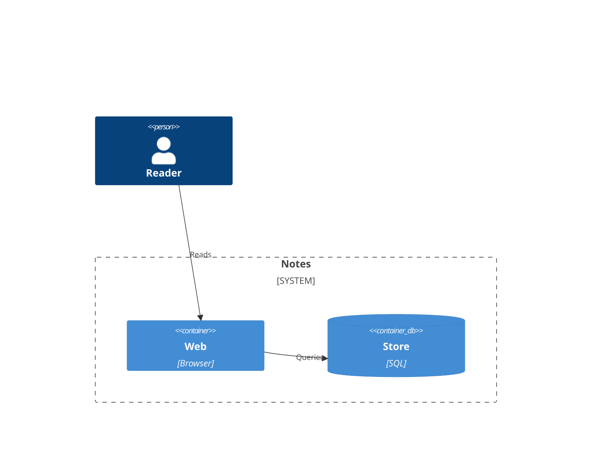
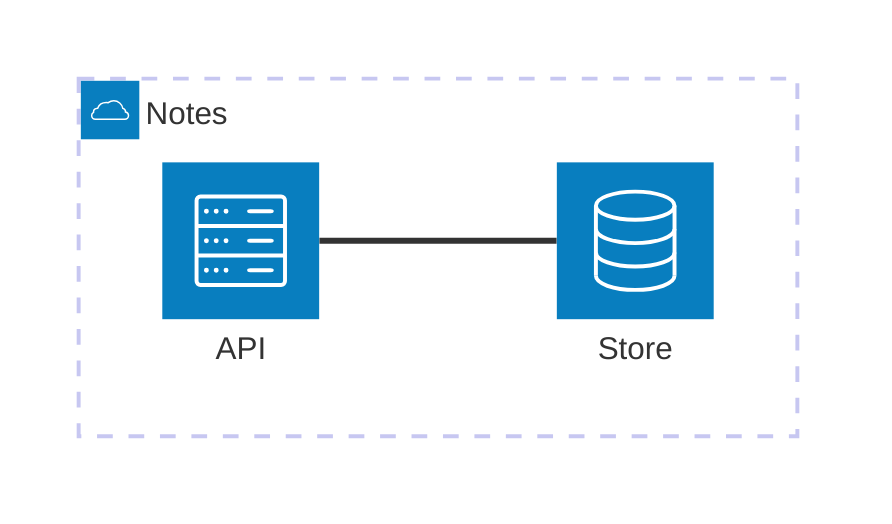

# Mermaid 12.0.0: software structures

Read only for the requested family. Examples are illustrative. Each family has its own grammar; use strict mode and avoid external icon packs.

## Classes

Use `<|--` for inheritance, `*--` for composition and `-->` for association. Visibility prefixes are `+/-/#`; multiplicities use quoted edge-end labels. Generics use tildes, e.g. `List~Item~`.



## States

Use `[*]` for start/end, braces for composite states, `<<choice>>` for decisions and `--` inside a composite for concurrent regions. Transition labels follow a colon.



## Entities

Use crow's-foot cardinalities and attribute blocks; `PK`, `FK`, `UK` and quoted comments annotate fields.



## Requirements

Declare requirements/elements, then connect them with contains, derives, satisfies, verifies, refines, traces or copies relations. Use accepted risk and verification-method values.



## C4 context

C4 uses function-like declarations and relationships. Other views include C4Container, C4Component, C4Dynamic and C4Deployment; validate the selected view's syntax.



## C4 container

Use boundaries to group containers. Types include Container, ContainerDb and ContainerQueue.



## Use cases

Declare actors, named cases and arrows. Check boundary and include/extend syntax before adding it.

```mermaid
usecase-beta
  actor Reader("Reader")
  Browse("Browse notes")
  Search("Find a note")
  Reader --> Browse
  Reader --> Search
```

## Architecture

Declare groups/services before edges. Use built-in cloud/database/disk/internet/server icons. Edge endpoints specify sides L/R/T/B; junctions model shared connections.


