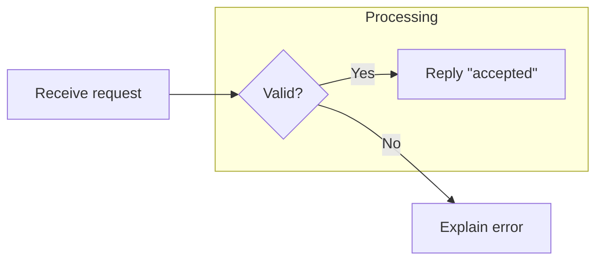
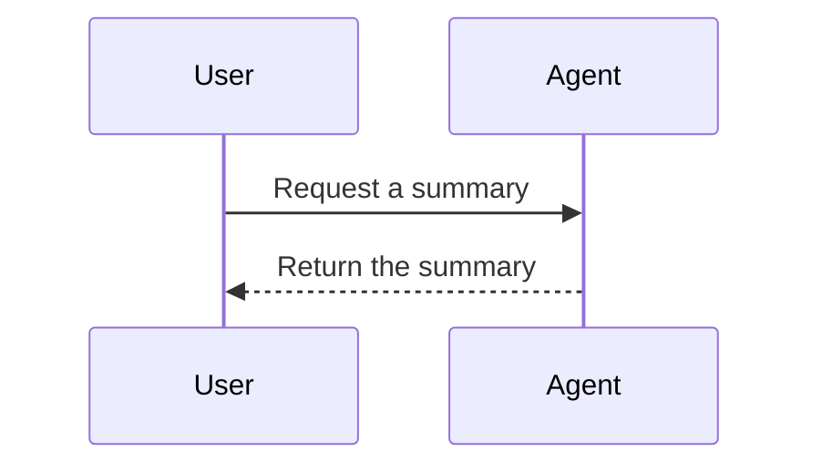
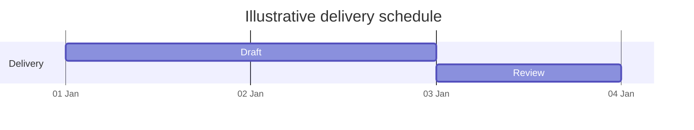

# Mermaid response diagrams

Use `usediagrams=true` (alias `usemermaid=true`) and a `mermaid` fence containing diagram text, not JSON or HTML. Prefer established diagram types and small diagrams. These examples describe illustrative processes.

## Flowchart

Use simple stable identifiers and quoted labels. Group related steps with subgraphs. For double quotes inside flowchart labels use `#quot;`, not JavaScript backslash escaping. Use ` ` for a line break in a traditional quoted label.

## Sequence

Define participants and describe messages in time order. Flowchart node/quote rules do not apply to sequence messages or participant aliases.

## Schedule

Use `gantt` for dated work, with explicit date format and task identifiers. Use actual dates/durations for real schedules.

## Checks and fallback

Check the diagram keyword, identifiers, balanced brackets, and diagram-specific syntax. Preserve the renderer's strict security mode; avoid scripts, click handlers, or external integrations. Prefer theme defaults, concise labels, and a caption explaining the relationship.

Other enabled built-in types include class/state/entity diagrams, timelines, and mind maps. XY charts (`xychart-beta`) support bars/lines; use Chart.js for scatter plots when enabled. `treemap-beta` is a valid keyword; `treemap-meta` is not. ZenUML requires an external registration that Mini-A's UI does not perform.

Use the loaded Mermaid library to parse/render when available. A parse success is weaker evidence than a visible diagram. If the library/version cannot render the diagram, simplify to flowchart/sequence syntax or provide the steps/relationships in text; do not assert a successful render without observing one.
